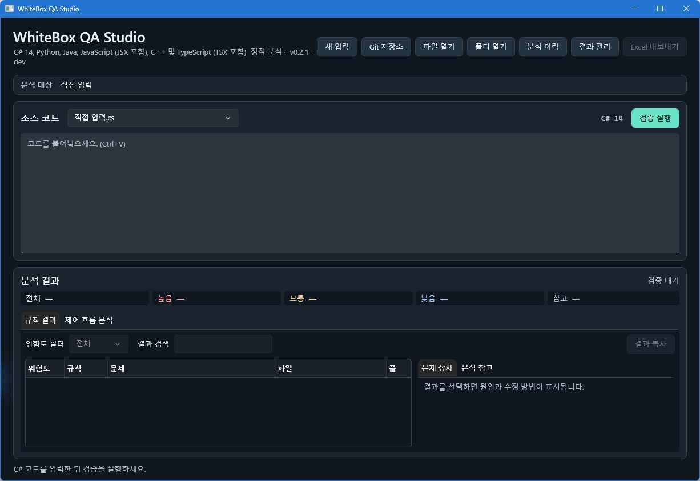
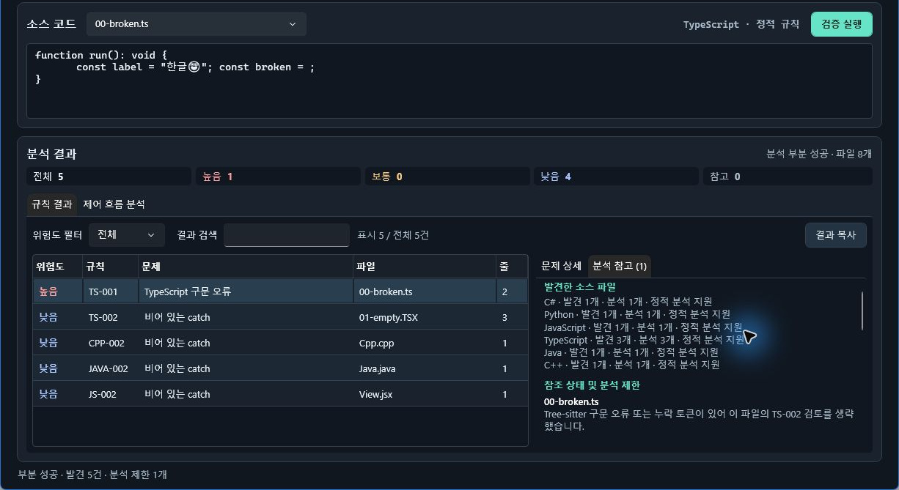
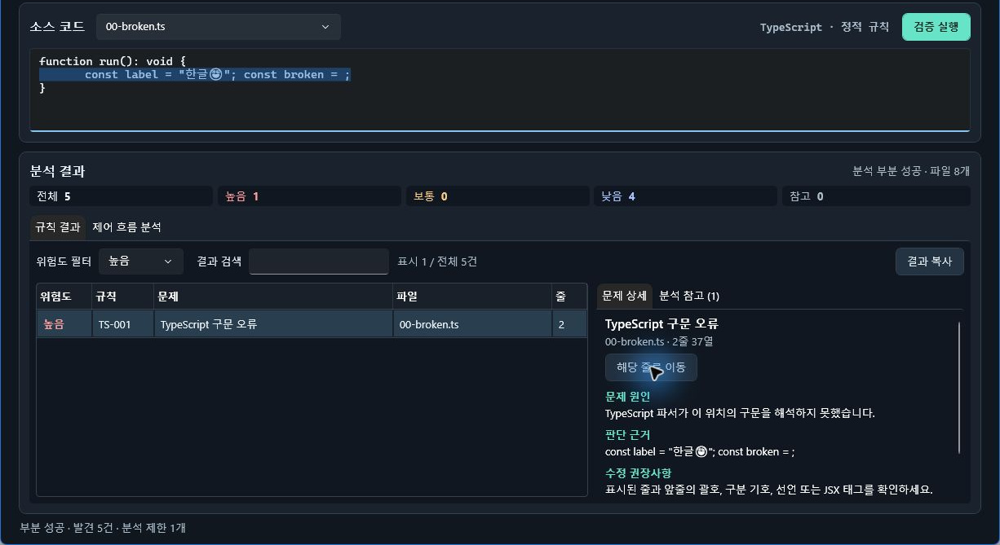
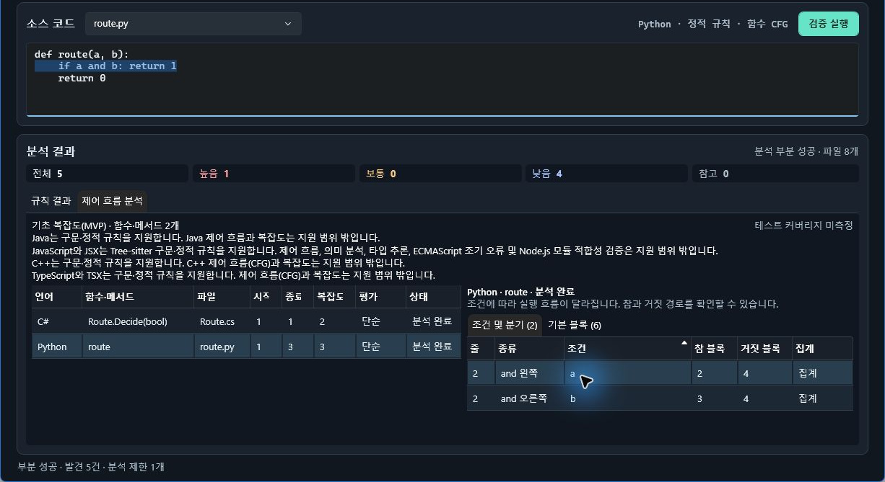
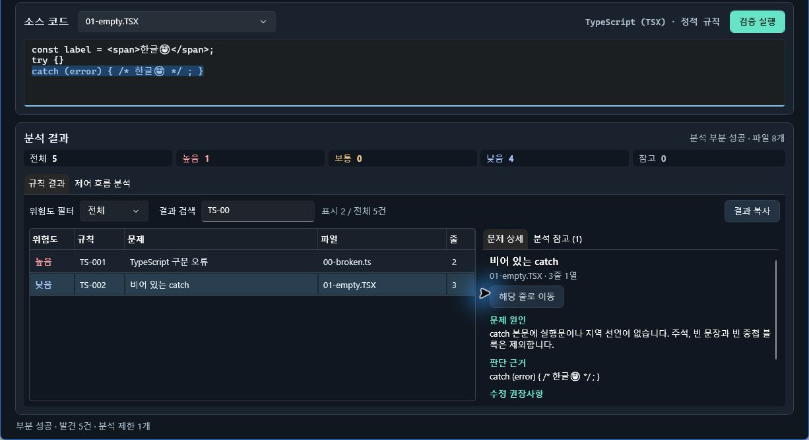
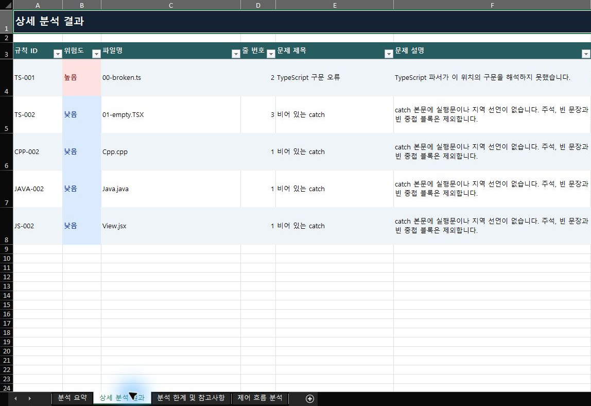

# WhiteBox QA Studio

[](https://github.com/rake8368-create/WhiteBox-QA-Studio-Portfolio/actions/workflows/dotnet-ci.yml?query=branch%3Amain)

**코드의 검토 지점을 찾아 원본 줄, 위험도, 판단 근거와 함께 보여주는 Windows 정적 분석 도구**입니다. 여러 언어가 섞인 폴더를 한 번에 검토하고 결과를 Excel로 남길 수 있습니다.

| 분석 언어 | 정적 규칙 | xUnit 기준 | 제품 버전 |
| --- | --- | --- | --- |
| 6개 | 16개 | 486개 통과, 실패·건너뜀 0 | `0.2.1-dev` |

[검증 보고서](docs/VERIFICATION.md) · [아키텍처](docs/ARCHITECTURE.md) · [제품 소스](src/) · [자동화 테스트](tests/) · [Windows CI](https://github.com/rake8368-create/WhiteBox-QA-Studio-Portfolio/actions/workflows/dotnet-ci.yml?query=branch%3Amain)

## 프로젝트와 QA 역할

예외가 조용히 무시되는 곳이나 잘못된 구문을 코드 리뷰 전에 발견하고, 개발자에게 수정 판단에 필요한 근거를 전달하기 위해 만들었습니다. 로컬 파일·폴더 또는 공개 HTTPS Git 기본 브랜치에서 소스를 읽고, 분석 대상 코드를 실행하지 않고 검토합니다.

개인 프로젝트의 요구사항, 언어별 분석 범위, 예외 사례, 회귀 테스트와 완료 기준을 정의했습니다. Codex를 활용해 구현·리뷰·테스트를 반복했고, 최종 판단은 xUnit 결과, Windows 게시 스모크, 제품 GUI와 내보낸 보고서를 근거로 확인했습니다.

## 실제 제품 화면



| 검토 단계 | 실제 화면 |
| --- | --- |
| 혼합 입력의 언어별 파일 집계 | [6개 언어 혼합 분석](docs/screenshots/02-mixed.jpg) |
| 위험도 선택과 소스 줄 강조 | [위험도 필터 및 원본 줄 이동](docs/screenshots/03-filter-line.jpg) |
| 조건·분기와 기본 블록 | [Python CFG](docs/screenshots/04-cfg.jpg) |
| TS-001 구문 오류와 TS-002 빈 catch | [TypeScript·TSX 분석](docs/screenshots/05-typescript.jpg) |
| 분석 결과와 네 개 시트 | [Excel 보고서](docs/screenshots/06-excel.jpg) |


<details>
<summary>나머지 실제 화면 5장 보기</summary>











</details>

## 지원 언어

| 언어 | 파일 확장자 | 기능 |
| --- | --- | --- |
| C# | `.cs` | 정적 규칙, 메서드 CFG·기초 복잡도 |
| [Python](docs/PYTHON_ANALYSIS_SCOPE.md) | `.py`, `.pyi` | 정적 규칙, 함수 CFG·기초 복잡도 |
| [Java](docs/JAVA_ANALYSIS_SCOPE.md) | `.java` | 정적 규칙 |
| [JavaScript·JSX](docs/JAVASCRIPT_ANALYSIS_SCOPE.md) | `.js`, `.mjs`, `.cjs`, `.jsx` | 정적 규칙 |
| [C++](docs/CPP_ANALYSIS_SCOPE.md) | `.cpp`, `.cc`, `.cxx`, `.hpp`, `.hh`, `.hxx` | 정적 규칙 |
| [TypeScript·TSX](docs/TYPESCRIPT_ANALYSIS_SCOPE.md) | `.ts`, `.mts`, `.cts`, `.tsx` | 정적 규칙 |

`.c`는 확장자만 식별하고 `.h`는 미식별로 처리합니다.

## 16개 분석 규칙

| 규칙 | 위험도 | 검토 항목 |
| --- | --- | --- |
| WB-001 | 보통 | C# 빈 `catch` |
| WB-002 | 낮음 | C#에서 잡은 예외 변수를 직접 다시 던지는 지점 |
| WB-003 | 높음 | Roslyn C# 구문 오류 |
| PY-001 | 높음 | Python 구문 오류와 일부 들여쓰기 오류 |
| PY-002 | 낮음 | 처리 코드가 없는 Python `except` |
| PY-003 | 보통 | 예외 타입을 지정하지 않은 Python `except` |
| PY-004 | 낮음 | Python에서 잡은 예외 변수를 이름으로 다시 던지는 지점 |
| JAVA-001 | 높음 | Java 구문 오류와 누락 토큰 |
| JAVA-002 | 낮음 | Java 빈 `catch` |
| JAVA-003 | 보통 | Java `Throwable` 또는 `java.lang.Throwable`을 잡는 구문 |
| JS-001 | 높음 | JavaScript·JSX 구문 오류와 누락 토큰 |
| JS-002 | 낮음 | JavaScript·JSX 빈 `catch` |
| CPP-001 | 높음 | C++ 구문 오류와 누락 토큰 |
| CPP-002 | 낮음 | C++ 빈 `catch` |
| TS-001 | 높음 | TypeScript·TSX 구문 오류와 누락 토큰 |
| TS-002 | 낮음 | TypeScript·TSX 빈 `catch` |

## 분석 구조

`로컬·공개 HTTPS Git → 언어 식별 → Roslyn / Tree-sitter → 규칙·지원 CFG → WPF / JSON v1 / Excel`

언어별 분석기가 공통 결과 모델에 규칙 ID, 위험도와 원본 좌표를 기록합니다. WPF에서 규칙·위험도로 결과를 좁혀 원본 줄로 이동할 수 있습니다. JSON v1은 이력을 저장하고 Excel은 요약, 규칙, 분석 참고, 제어 흐름을 네 시트에 기록합니다. [아키텍처](docs/ARCHITECTURE.md)

## 결함 수정 사례

- **단일 EXE의 네이티브 추출 경로 충돌** — 게시 스테이징과 추출 폴더를 분리하고 호출별·스모크별 추출 경로를 부여했습니다. 스모크 실패 시 이전 EXE와 호출자 환경을 보존하는 회귀 검증을 추가했습니다. [게시 스크립트](scripts/publish-win-x64.ps1) · [회귀 테스트](tests/PublishScripts.Tests.ps1)
- **구버전 C++ 이력이 분석 완료로 보일 수 있는 호환성 문제** — 신규 분석기 지원 여부와 저장된 이력의 분석 여부를 분리했습니다. 이전 C++ 항목의 발견 수와 분석 0건을 보존하는 xUnit 테스트가 이를 검증합니다. [C++ 통합 테스트](tests/WhiteBoxQA.Tests/CppIntegrationTests.cs)

## 빌드, 실행 및 검증

Windows x64, .NET 10 SDK, PowerShell 7을 사용합니다. 공개 HTTPS Git 가져오기에는 PATH에 있는 Git 실행 파일이 필요합니다.

```powershell
dotnet build WhiteBoxQA.slnx -c Release -warnaserror
dotnet test WhiteBoxQA.slnx -c Release --no-build --logger "trx;LogFileName=portfolio.trx" --results-directory TestResults
pwsh -File ./scripts/publish-win-x64.ps1
.\dist\current\win-x64\WhiteBoxQA.App.exe
```

**폴더 열기**에서 [혼합 검증 샘플](samples/portfolio-mixed/)을 선택하고 **검증 실행**을 누릅니다. `TS-001`을 검색하고 위험도 **높음**을 선택한 뒤 결과 상세의 **해당 줄로 이동**을 눌러 보세요. **제어 흐름 분석**에서는 C#·Python 결과를 확인할 수 있습니다.

원본 기준에서 Release 경고·오류 0건, xUnit 486개 통과, 단일 EXE 스모크 5개 통과, Tree-sitter DLL 7개 추출을 확인했습니다. 공개 Windows CI는 같은 빌드·테스트·게시 게이트를 실행합니다. [검증 보고서](docs/VERIFICATION.md) · [공개 CI 실행 목록](https://github.com/rake8368-create/WhiteBox-QA-Studio-Portfolio/actions/workflows/dotnet-ci.yml?query=branch%3Amain)

## 범위와 한계

- CFG와 기초 복잡도는 C#과 Python의 지원 구문에서 제공합니다. 실행 커버리지나 분석 대상 테스트 실행은 제공 범위 밖입니다. [CFG 설계](docs/CONTROL_FLOW_DESIGN.md)
- Tree-sitter 오류는 파서의 구문 복구 결과입니다. C++ 전처리 평가, TypeScript 타입 검사·추론과 모듈 해석, 컴파일러 수준의 분석은 제공 범위 밖입니다. TSX 여닫는 태그 이름 불일치는 미탐지될 수 있습니다.
- 구문 오류 파일에서는 일부 빈 catch 규칙을 생략합니다. C++ 전처리 조건과 가져오기·파싱 한도에 의한 제한은 **분석 참고**에 표시합니다.
- 이 저장소는 채용 검토용 공개 소스 스냅샷입니다. 사용된 구성 요소의 권리·조건은 [서드파티 고지](docs/THIRD_PARTY_NOTICES.txt)에서 확인할 수 있습니다.
