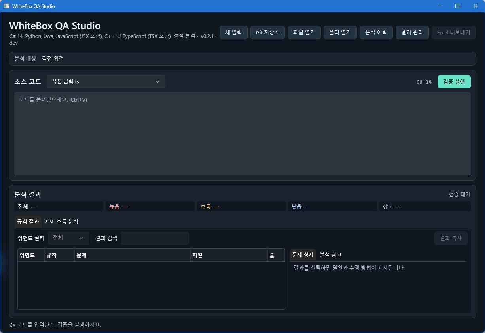
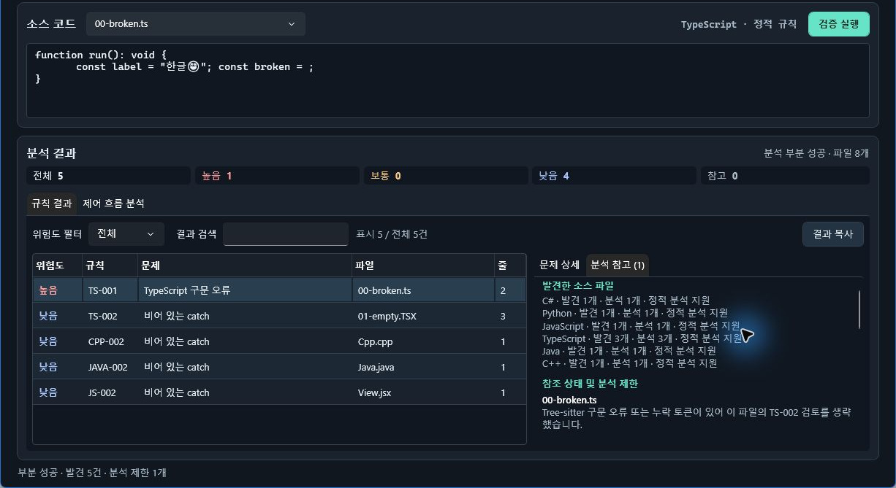
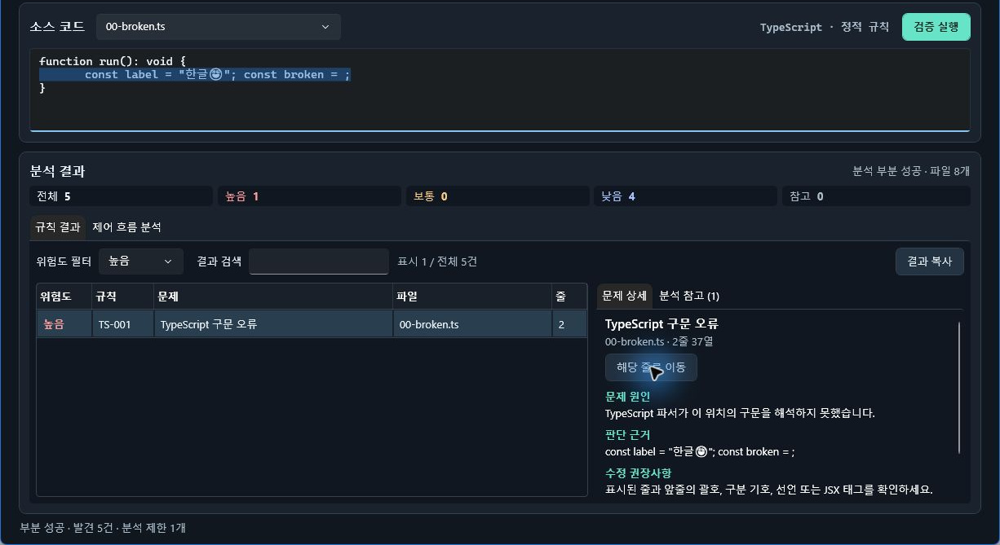
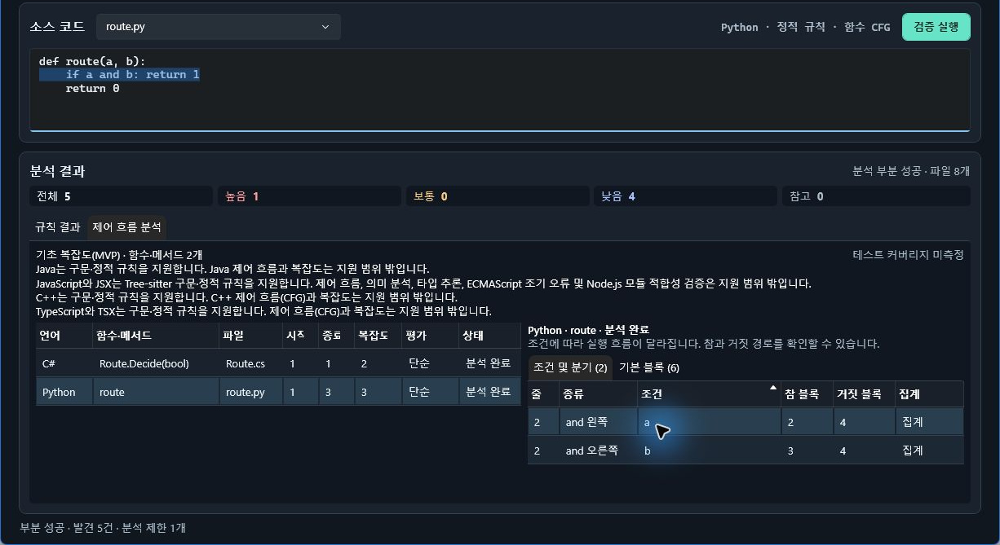
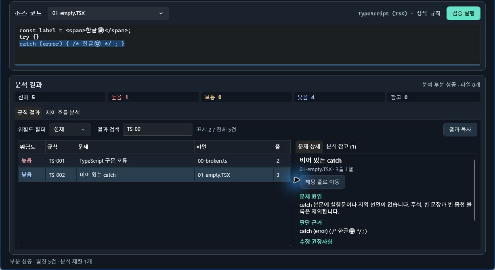
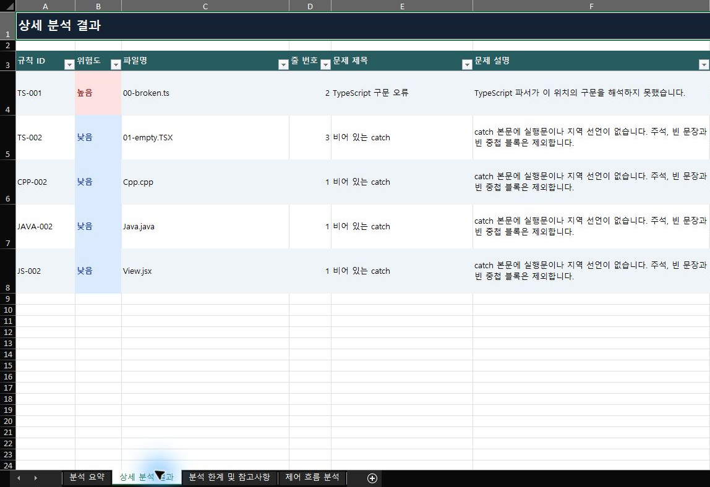

# WhiteBox QA Studio 검증 보고서

검증 대상은 Windows x64용 `0.2.1-dev`입니다. 6개 언어에서 16개 정적 규칙을 제공하고, C#·Python의 지원 구문에서 CFG와 기초 복잡도를 표시합니다. 분석 대상 프로그램의 실행이나 테스트 커버리지는 검증 범위 밖입니다.

## 자동화 및 배포

| 검증 | 확인 결과 | 재현·증거 |
| --- | --- | --- |
| 로컬 Release | .NET SDK 10.0.401, `-warnaserror`, 경고 0·오류 0 | [솔루션](../WhiteBoxQA.slnx) |
| 로컬 xUnit | 486/486 통과, 실패·건너뜀 0 | [테스트 소스](../tests/WhiteBoxQA.Tests/) |
| Windows x64 단일 EXE | 제품 EXE 1개, Tree-sitter DLL 7개, 버전 `0.2.1-dev` | [게시 프로필](../src/WhiteBoxQA.App/Properties/PublishProfiles/WinX64SingleFile.pubxml) |
| 게시 스모크 | Python·CFG, Java·C# CFG, JavaScript·JSX, C++, TypeScript·TSX의 다섯 진입점 | [게시 스크립트](../scripts/publish-win-x64.ps1) · [스크립트 회귀](../tests/PublishScripts.Tests.ps1) |
| 공개 Windows CI | 공개 `main`의 실행별 결과와 커밋 확인 | [실행 목록](https://github.com/rake8368-create/WhiteBox-QA-Studio-Portfolio/actions/workflows/dotnet-ci.yml?query=branch%3Amain) · [워크플로](../.github/workflows/dotnet-ci.yml) |

최초 공개 스냅샷의 Windows CI에서 Release 경고·오류 0건, xUnit 486/486 통과·실패 0·건너뜀 0, Windows x64 단일 EXE와 스모크 다섯 개, 게시 스크립트와 버전을 확인했습니다. xUnit 수치는 실행 로그와 TRX의 카운터가 일치합니다. [공개 검증 실행](https://github.com/rake8368-create/WhiteBox-QA-Studio-Portfolio/actions/runs/45509589489)

단일 EXE에서 추출된 네이티브 파일은 Tree-sitter 런타임, Python, Java, JavaScript, C++, TypeScript, TSX DLL입니다. 빌드와 앱 버전, 게시 스모크, 게시 실패 시 이전 EXE 보존은 서로 다른 검증 항목으로 다룹니다.

## 제품 화면 검증

공개 [샘플](../samples/portfolio-mixed/)을 최신 로컬 EXE에서 직접 열었습니다. 8개 파일을 발견하고 분석했습니다. 높음 1건과 낮음 4건을 표시했으며, 구문 오류 파일에서 TS-002를 생략한 사유를 분석 참고 1건으로 기록했습니다.

| 항목 | 기대 및 관찰 |
| --- | --- |
| 혼합 분석 | C#·Python·Java·JavaScript·C++ 각 1/1, TypeScript·TSX 3/3의 발견·분석 수 |
| 필터와 원본 위치 | `높음` 선택 시 TS-001 1건. 해당 줄로 이동하면 `00-broken.ts` 2행 강조, 상세 좌표 2행 37열 |
| TS·TSX 검색 | `TS-00`으로 TS-001·TS-002 두 행. `01-empty.TSX` 3행 1열로 이동하고 한글·이모지 소스 표시 |
| CFG | C# `Route.Decide(bool)` 기초 복잡도 2. Python `route`는 3, `and`의 두 조건 블록과 원본 2행 강조 |
| Excel | 실제 저장 대화상자로 합성 데이터 보고서 생성. 분석 요약, 상세 분석 결과, 분석 한계 및 참고사항, 제어 흐름 분석 네 시트와 진단 5건 확인 |
| JSON v1 | 테스트용 이력에 자동 저장. 구버전 식별 전용 이력 복원은 [C++](../tests/WhiteBoxQA.Tests/CppIntegrationTests.cs) 및 [TypeScript](../tests/WhiteBoxQA.Tests/TypeScriptIntegrationTests.cs) 회귀 테스트에서 확인 가능 |

경로와 Office 계정 영역을 제외하도록 실제 창 캡처의 바깥 영역을 잘랐습니다. 화면 안의 소스, 진단과 수치는 제품이 표시한 값입니다.

### 메인 화면

### 다중 언어 분석

### 위험도와 원본 위치

### Python CFG

### TypeScript·TSX

### Excel 보고서

## 공개 스냅샷 기준

- 기준 커밋 `166d59498967879f5a03dd5deafbc68d2016995d`, 기준 tree `f71a79999e0da38398afcf672bd0354a39e7618c`.
- 제품 소스, 기존 테스트·샘플, 스크립트, 솔루션·빌드 설정과 서드파티 고지는 기준 Git blob과 비교했습니다.
- 공개용 README, 아키텍처, 검증 보고서, 합성 샘플 및 화면을 추가했습니다. 범위 문서의 참조와 게시 구성 설명을 공개본에 맞췄고 Windows CI의 push 대상은 `main`으로 정리하고 xUnit 수치 검증과 실행 요약을 추가했습니다.

[README](../README.md) · [아키텍처](ARCHITECTURE.md) · [서드파티 고지](THIRD_PARTY_NOTICES.txt)
